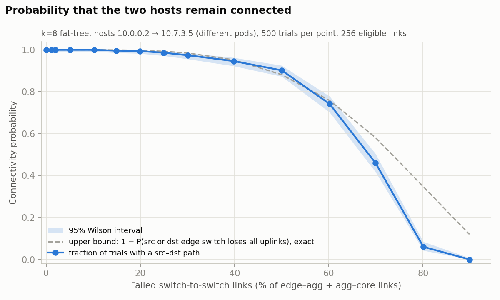
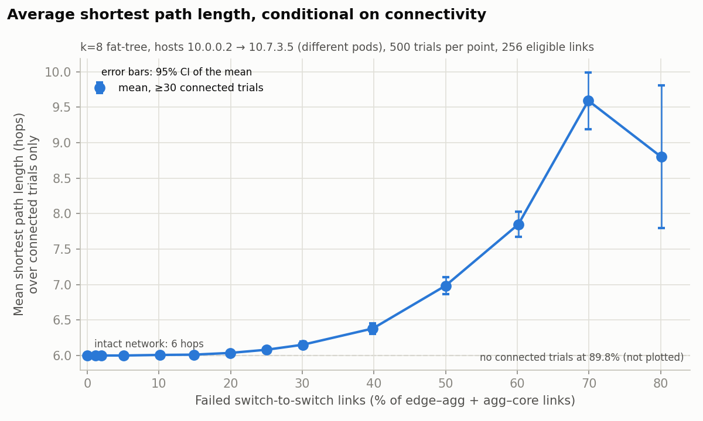
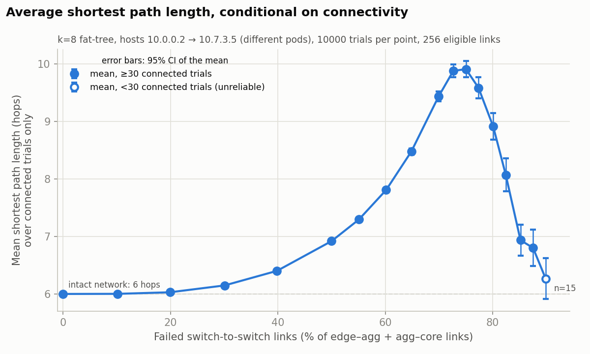
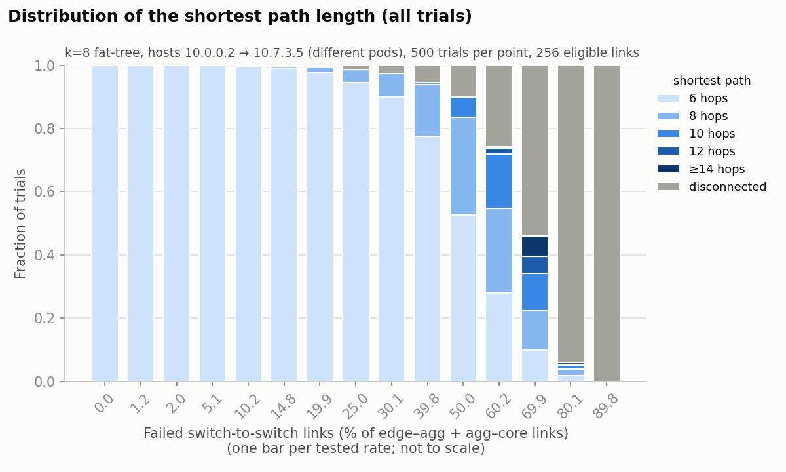

# HW1 – Fat-Tree Topology Generation and Failure Analysis

Course 361.2.2460 – Communication networks for data centers and AI, Semester A 2026/27.

This project builds the **canonical k-ary fat-tree** of Al-Fares, Loukissas and Vahdat [1],
injects **random switch-to-switch link failures**, and measures how the **shortest path
between two hosts in different pods** responds as the failure fraction grows.

**Research question.** *How does the average shortest-path length between two hosts in
different pods change as the fraction of failed inter-switch links increases — and how
likely is it that the two hosts are still connected at all?*

Everything (graph, failures, BFS, statistics) is plain Python standard library.
`matplotlib` is used only for the plots.

---

## 1. The fat-tree topology (paper, Section 2.2 and Figure 3)

A k-ary fat-tree is built from identical k-port switches (k even), arranged in three tiers:

| Element | Count | k = 4 | k = 8 | k = 48 |
|---|---|---|---|---|
| Pods | k | 4 | 8 | 48 |
| Edge switches per pod | k/2 | 2 | 4 | 24 |
| Aggregation switches per pod | k/2 | 2 | 4 | 24 |
| Core switches | (k/2)² | 4 | 16 | 576 |
| Switches in total | 5k²/4 | 20 | 80 | 2,880 |
| Hosts | k³/4 | 16 | 128 | 27,648 |
| Host–edge links | k³/4 | 16 | 128 | 27,648 |
| Edge–aggregation links | k·(k/2)² = k³/4 | 16 | 128 | 27,648 |
| Aggregation–core links | k·(k/2)·(k/2) = k³/4 | 16 | 128 | 27,648 |
| Switch-to-switch links (eligible to fail) | k³/2 | 32 | 256 | 55,296 |

Connectivity rules:

* **Host – edge.** Each edge switch uses k/2 ports for k/2 hosts.
* **Edge – aggregation.** Each edge switch's other k/2 ports go to *every* aggregation
  switch of its own pod. Inside a pod this is a complete bipartite graph K(k/2, k/2).
* **Aggregation – core.** The paper says: "*The i-th port of any core switch is connected
  to pod i such that consecutive ports in the aggregation layer of each pod switch are
  connected to core switches on (k/2) strides.*" Number the (k/2)² cores row by row as a
  grid `(j, i)`, with `j, i ∈ [1, k/2]` (the paper's `10.k.j.i` addresses). Then
  **aggregation switch `a` of every pod connects to the k/2 cores of row `j = a+1`**, and
  core `(j, i)` connects to aggregation switch `j−1` of each of the k pods (one port per
  pod). For k = 4 this gives exactly the links in Figure 3: `10.0.2.1 ↔ 10.4.1.1, 10.4.1.2`
  and `10.0.3.1 ↔ 10.4.2.1, 10.4.2.2`. A unit test checks this.

So every switch has degree exactly k. Between two hosts in different pods there are
exactly (k/2)² shortest paths of 6 hops (host → edge → agg → core → agg → edge → host).
The paper quotes 576 such paths for k = 48. Both facts are unit-tested.

The graph is **bipartite**: every link joins adjacent tiers, so every host-to-host path
has an **even** number of hops. That is why the measured path lengths are 2, 4, 6, 8, 10, ….

## 2. Implementation

| File | Contents |
|---|---|
| [topology.py](topology.py) | `build_fat_tree(k)` → `FatTree(k, adj, links)`; `expected_counts`, `link_kind`, `is_switch_link`, `paper_address` (the paper's `10.pod.switch.id` names) |
| [failures.py](failures.py) | `eligible_links`, `num_links_to_fail` (rounding rule), `random_failure_order`, `remove_links`, `fail_random_links` |
| [bfs.py](bfs.py) | Our own BFS: `shortest_path_length(adj, src, dst)` (returns `None` if disconnected) and `bfs_distances(adj, src)` |
| [stats_utils.py](stats_utils.py) | Wilson interval, mean ± 95% CI, hypergeometric "all m links failed" probability |
| [generate.py](generate.py) | CLI: build one topology, optionally fail links, print a report and/or an edge list |
| [experiment.py](experiment.py) | CLI: the Monte-Carlo experiment; writes CSV/JSON results and calls the plotter |
| [plot_results.py](plot_results.py) | Draws the three figures from `summary.csv` (can be re-run without re-simulating) |
| [tests/](tests/) | 38 `unittest` tests (topology, failures, BFS, experiment, statistics) |
| [results/](results/) | Generated results: `main/` (500 trials) and `zoom/` (10,000 trials) |

**Graph representation.** The graph is an adjacency list, `adj: dict[node, set[node]]`.
Nodes are readable tuples whose first field is the tier:
`("host", pod, edge, h)`, `("edge", pod, e)`, `("agg", pod, a)`, `("core", j, i)`.
`FatTree.links` also keeps every undirected link exactly once, in a fixed build order.
The fixed order matters for reproducibility: Python randomizes the hash of strings per
process, so the iteration order of a `set` of tuples can change between runs. Random
selection is therefore always made from this ordered list, never from a set.

**BFS.** This is the textbook queue-based BFS (`collections.deque`). It stops as soon as
the destination is discovered. Because all links have unit weight, BFS discovers nodes
in non-decreasing distance order, so the first time `dst` is reached its label is the
shortest distance. Hosts have degree 1, so they can never be intermediate nodes.

## 3. Requirements and installation

* Python ≥ 3.8 (developed and tested with Python 3.13.7)
* `matplotlib` (plots only; tested with 3.10.8)

```bash
pip install -r requirements.txt
```

## 4. How to run

All commands are run from the repository root.

```bash
# Topology generation (+ optional failures)
python generate.py --k 4
python generate.py --k 8 --failure-percent 30 --seed 1
python generate.py --k 8 --failure-rate 0.3 --seed 1 --src 10.0.0.2 --dst 10.5.1.3 --show-failed
python generate.py --k 4 --failure-percent 25 --edges-out topo_k4.txt

# Main experiment (k=8, 500 trials per rate, ~1 s) -> results/main/
python experiment.py --outdir results/main

# High-precision confirmation run (10,000 trials, finer grid, ~25 s) -> results/zoom/
python experiment.py --trials 10000 --percents 0 10 20 30 40 50 55 60 65 70 72.5 75 77.5 80 82.5 85 87.5 90 --outdir results/zoom

# Re-draw plots from saved results
python plot_results.py results/main

# Tests
python -m unittest discover -s tests -v
```

Example output of `python generate.py --k 8 --failure-percent 30 --seed 1`:

```
k = 8 fat-tree
  host  nodes :    128   (expected 128)
  edge  nodes :     32   (expected 32)
  agg   nodes :     32   (expected 32)
  core  nodes :     16   (expected 16)
  host-edge links:    128   (expected 128)
  edge-agg  links:    128   (expected 128)
  agg-core  links:    128   (expected 128)
  switch degrees (intact): [8]

Failures: requested rate 0.3, seed 1
  eligible (switch-switch) links: 256
  failed links: 77  (= 30.08% of eligible)
  failed by kind: {'edge-agg': 35, 'agg-core': 42}
  edge switches with no uplink left: 0
  hosts reachable from 10.0.0.2: 128 / 128

Shortest path 10.0.0.2 -> 10.7.3.5: 6 hops
```

## 5. Input parameters

### `generate.py`

| Parameter | Default | Meaning / validation |
|---|---|---|
| `--k` | 4 | Switch port count. Must be an even integer ≥ 2, otherwise error. |
| `--failure-rate` | 0 | Fraction of switch-to-switch links to fail, in [0, 1]. |
| `--failure-percent` | – | The same value given as a percentage in [0, 100]. Mutually exclusive with `--failure-rate`. |
| `--seed` | 0 | Seed of the random failure draw (`random.Random(seed)`). |
| `--src`, `--dst` | `10.0.0.2`, last host of pod k−1 | Hosts in the paper's address format `10.pod.edge.id`, with id ∈ [2, k/2+1]. Validated against k. |
| `--edges-out PATH` | – | Write the surviving links as `u v kind` lines. |
| `--show-failed` | off | List every failed link. |

### `experiment.py`

| Parameter | Default | Meaning |
|---|---|---|
| `--k` | 8 | Port count (even, ≥ 2) |
| `--trials` | 500 | Independent trials per failure rate (≥ 1) |
| `--percents` | `0 1 2 5 10 15 20 25 30 40 50 60 70 80 90` | Failure percentages to test, each in [0, 100] |
| `--seed` | 2026 | Master seed |
| `--src`, `--dst` | `10.0.0.2`, `10.(k−1).(k/2−1).(k/2+1)` | Must be in different pods |
| `--outdir` | `results` | Where CSV/JSON/PNG files are written |
| `--no-plot` | off | Skip plotting |

## 6. Failure model

* **Eligible links.** Only switch-to-switch links (edge–agg and agg–core), N = k³/2 of
  them (256 for k = 8). Host–edge links never fail in this experiment: a host is
  single-homed, so failing its access link would just measure that one link's state.
* **How many.** n = ⌊f·N + 0.5⌋ links fail, i.e. the nearest integer, with ties rounded
  up. The *actual* failed fraction n/N is recorded and used on every plot's x-axis. For
  example, 10% of 256 = 25.6 → 26 links = 10.16%.
* **Which ones.** n distinct links are chosen uniformly at random without replacement.
  Mechanically, each trial draws one uniformly random permutation of the N eligible links
  (`rng.sample(links, N)`), and rate f fails its first n links. A prefix of a uniform
  permutation is a uniform n-subset, so each rate on its own is exactly "n links chosen
  uniformly". A statistical unit test checks that every link fails with frequency ≈ n/N.
* **Nested failure sets.** Within one trial, the same permutation is used for every rate,
  so the links down at 20% are a superset of those down at 10% (common random numbers).
  Different trials are independent. Consequences: (i) each point on the plots is still an
  unbiased estimate based on independent trials; (ii) neighbouring points are positively
  correlated, so curves look smoother than independent samples would; (iii) within a
  trial, connectivity can only be lost and distance can only grow as f increases. A unit
  test checks (iii).
* **Nodes are kept.** Removing links never removes nodes. A switch whose links have all
  failed simply has an empty neighbour set.
* **Reproducibility.** Trial t uses seed `s_t = random.Random(master_seed).getrandbits(64)`
  (the t-th draw). Every `s_t` is saved in `trials.csv`, and
  `python generate.py --k 8 --failure-rate f --seed s_t` rebuilds exactly the failed
  topology of trial t (also unit-tested).

**Limitations of the model.** Failures are independent and uniform: there are no
correlated failures (line cards, whole switches, power domains) and no switch failures.
Failures are static: no repair process and no time dimension. Links are either fully up
or fully down (no degraded or lossy links).

## 7. Experimental methodology

* Topology: k = 8 (128 hosts, 80 switches, 256 eligible links).
* Hosts: `10.0.0.2` (pod 0, edge 0) → `10.7.3.5` (pod 7, edge 3). The fat-tree is
  symmetric: permuting pods, edges inside a pod, hosts on an edge, and aggregation
  indices (together with core rows) are all automorphisms. Any inter-pod host pair is
  therefore statistically equivalent, and the choice of pair does not matter.
* Failure rates: 0, 1, 2, 5, 10, 15, 20, 25, 30, 40, 50, 60, 70, 80, 90%.
* 500 trials per rate, master seed 2026 (`results/main`). A confirmation run with
  10,000 trials and a finer grid at high failure rates is in `results/zoom`.
* Per trial and rate: copy the intact adjacency list, remove the first n links of the
  trial's permutation, and run BFS from src to dst. Record the distance, or *disconnected*.

**Metrics** (T trials at one rate, C of them connected, d_t the distance in trial t):

* **A. Conditional mean shortest-path length** = (1/C) · Σ_{t connected} d_t.
  Disconnected trials are *excluded*; they are not assigned a finite distance. The error
  bar is the 95% normal-approximation CI of the mean, ±1.96·s/√C. Points with C < 30 are
  drawn hollow and labelled with n, and points with C = 0 are omitted and noted on the plot.
* **B. Connectivity probability** p̂ = C/T, with a 95% **Wilson** score interval. The
  Wilson interval stays inside [0, 1] and is valid near 0 and 1, where the normal interval
  fails (e.g. 500/500 → [0.992, 1]).
* **Analytic reference curve.** If the source (or destination) edge switch loses all k/2
  of its uplinks, the hosts are certainly disconnected. With n of N links failed
  uniformly, the probability that m given links are all down is
  h(m) = C(N−m, n−m)/C(N, n). The two edge switches are in different pods and have
  disjoint uplinks, so by inclusion–exclusion
  P(src or dst edge isolated) = 2·h(k/2) − h(k).
  Therefore **P(connected) ≤ 1 − [2·h(k/2) − h(k)]**. This is plotted as a dashed line.
  It was also verified against a 20,000-trial simulation (e.g. 60%: analytic 0.2419 vs
  simulated 0.2415).

**What is measured — and what is not.** The metric is the hop count of the shortest
path in the *physical connectivity graph* after failures. It is **not** packet latency,
and **not** the path that the paper's two-level routing tables or its failure-broadcast
scheme (Sec. 3.8) would actually choose. It is a property of the cabling: the best that
*any* routing could do.

## 8. Results

All numbers below are copied from `results/main/log.txt` (500 trials) and
`results/zoom/log.txt` (10,000 trials). The raw data is in `summary.csv` / `trials.csv`
in each folder.

### 8.1 Connectivity probability



*Setup: k = 8, hosts 10.0.0.2 → 10.7.3.5, 500 trials per point, uniform failures of
switch-to-switch links. Shaded: 95% Wilson interval. Dashed: exact upper bound from
edge-switch isolation.*

| Failed (actual) | P(connected), 500 trials [95% CI] | 10,000 trials | Edge-isolation bound |
|---|---|---|---|
| 0–10.2% | 1.000 [0.992, 1] | 1.000 (10.2%) | 1.000 |
| 19.9% | 0.994 [0.983, 0.998] | 0.998 | 0.997 |
| 30.1% | 0.974 [0.956, 0.985] | 0.986 | 0.985 |
| 39.8% | 0.946 [0.923, 0.963] | 0.953 | 0.952 |
| 50.0% | 0.902 [0.873, 0.925] | 0.880 | 0.881 |
| 60.2% | 0.742 [0.702, 0.778] | 0.729 | 0.758 |
| 69.9% | 0.460 [0.417, 0.504] | 0.451 | 0.581 |
| 80.1% | 0.060 [0.042, 0.084] | 0.062 | 0.347 |
| 89.8% | 0.000 [0, 0.008] | 0.002 | 0.120 |

**Discussion.**

* **Very robust up to moderate failure rates.** With up to 10% of switch links down, the
  two hosts were connected in all 500 trials. At 30%, about 98.6% of trials (10k run) are
  still connected.
* **Up to roughly 50–60%, almost all disconnections are caused by the edge tier.** The
  measured P(connected) lies on the edge-isolation bound: 0.880 vs 0.881 at 50%, and
  0.953 vs 0.952 at 40% (10k trials). In other words, the hosts lose connectivity almost
  only when their *own* edge switch loses all k/2 = 4 uplinks. The aggregation and core
  layers have far more redundancy: an aggregation switch has 4 down- and 4 up-links, and
  there are 16 cores. Each host is single-homed, so the edge switch's k/2 uplinks are the
  bottleneck of resilience. This matches the paper's remark (Sec. 3.8) that tolerating
  lower-layer failures needs redundancy at the leaves.
* (In the 500-trial run the 50% point, 0.902, lies slightly *above* the bound, 0.881. The
  bound is inside its 95% CI, and with 10,000 trials the estimate is 0.880. This is
  sampling noise of about 1.5σ, not a violation.)
* **Beyond ~65%, the whole network falls apart.** The gap to the bound widens quickly
  (80%: 0.062 vs 0.347). Disconnection is now caused by fragmentation of the
  aggregation/core fabric itself, not just by an isolated edge switch. This is a
  percolation-like transition: P(connected) drops from 0.73 to 0.06 between 60% and 80%.

### 8.2 Average shortest path length, conditional on connectivity



*Setup as above. Mean over connected trials only; error bars are 95% CIs of the mean.
The 89.8% point is omitted because no trial was connected.*

| Failed (actual) | Mean length (500 trials) ± 95% CI | Connected trials | Mean (10k trials) |
|---|---|---|---|
| 0% | 6.000 ± 0 | 500 | 6.000 |
| 10.2% | 6.008 ± 0.011 | 500 | 6.002 |
| 19.9% | 6.036 ± 0.023 | 497 | 6.029 |
| 30.1% | 6.152 ± 0.047 | 487 | 6.148 |
| 39.8% | 6.381 ± 0.075 | 473 | 6.402 |
| 50.0% | 6.984 ± 0.118 | 451 | 6.918 |
| 60.2% | 7.849 ± 0.178 | 371 | 7.807 |
| 69.9% | 9.591 ± 0.399 | 230 | 9.432 |
| 80.1% | 8.800 ± 1.005 | 30 | 8.908 |
| 89.8% | – | 0 | 6.267 ± 0.356 (n = 15) |

**Discussion.**

* **Path stretch is negligible at realistic failure rates.** Up to 20% failed links, the
  mean grows by less than 0.04 hops. With 16 equal-cost 6-hop paths between any two pods,
  it is very likely that at least one of them survives.
* **Longer paths are detours of +2 hops each.** When every 6-hop path is broken, the
  shortest path has to go *down and back up*. For example, it goes
  edge → agg → (another edge in the same pod) → agg → core …, which takes 8 hops. Because
  the graph is bipartite, every detour adds an even number of hops.
* **Unexpected: the conditional mean is not monotone.** It rises to about 9.9 hops at
  73–75% failures and then *falls* back towards 6 (8.9 at 80%, 6.9 at 85%, 6.3 at 90% in
  the 10,000-trial run). The 500-trial run shows the start of this (9.59 at 70% →
  8.80 at 80%). Its error bars overlap, so we confirmed it with 10,000 trials:

  

  This is a **selection (survivorship) effect, not a property of a single network**.
  Because failure sets are nested, the distance in any *single* trial can only grow with
  f (unit-tested). The *average over connected trials* can still fall because the set of
  trials being averaged shrinks. A path whose m switch links must all survive exists with
  probability ∝ (1−f)^m. When (1−f) is small, long paths (larger m) become impossible much
  faster than short ones. So, among the few configurations that stay connected at 85–90%,
  most are connected through a surviving *short* path. In the mid range, there are still
  many long detour paths, and they make up for their lower survival probability; at the
  extreme they cannot. Metric A therefore has to be read together with Metric B: at 90%
  "average 6.3 hops" describes only 0.2% of the trials.

### 8.3 Supporting view: full distribution of the shortest path



This stacked chart (all trials, including disconnected ones) explains both previous
plots at once: the 6-hop share shrinks, 8-, 10- and longer detours appear, and the grey
"disconnected" share takes over beyond ~60%. It also gives a useful reading for
practice. **In a fat-tree, every host-to-host path between pods that is longer than 6 hops
is a "valley" path: it goes down and up again.** Upward-then-downward routing, as used by
the paper's two-level tables, never uses such paths. At 30% failures, a 6-hop path still
exists in 90.0% of trials (450/500). In another 7.4% of trials the hosts are physically
connected only through a valley path, which a standard fat-tree routing scheme would not
use. Physical connectivity is therefore an *optimistic* (upper-bound) view of what routing
can deliver.

### 8.4 Significance

* The fat-tree's path diversity makes the *physical* topology extremely tolerant of
  random inter-switch link failures. Path stretch and disconnection are negligible up to
  about 10–20% failed links. Real data-center link failure rates are far lower than this.
* The resilience limit is set by the **edge tier** (k/2 uplinks per edge switch, and
  single-homed hosts), not by the core. Increasing k gives more uplinks per edge switch,
  so this limit improves with switch radix.
* Under extreme failure, conditioning on connectivity hides the collapse. A path-length
  average must always be reported together with the connectivity probability.

## 9. Validation (tests)

`python -m unittest discover -s tests -v` → **Ran 38 tests, OK** (Python 3.13.7).

* **Topology** ([tests/test_topology.py](tests/test_topology.py)), for k ∈ {2, 4, 6, 8, 10, 16}:
  * node, pod, switch and per-tier link counts match the formulas;
  * every switch has degree k and every host has degree 1;
  * there are no duplicate links or self-loops, and the adjacency list matches the link list;
  * hosts and edges are wired correctly, and edge–agg is complete bipartite per pod;
  * core `(j,i)` connects to agg `j−1` of every pod, and agg `a` connects to the cores of row `a+1`;
  * specific links of Figure 3 and its 6-hop dashed path are present;
  * the intact graph is connected;
  * *all* host pairs for k = 4 and k = 6 have distance 2 (same edge), 4 (same pod) or
    6 (different pods);
  * the number of shortest paths is (k/2)² between pods, k/2 within a pod, and 1 under
    the same edge;
  * invalid k values are rejected.
* **Failures and BFS** ([tests/test_failures_bfs.py](tests/test_failures_bfs.py)):
  * BFS is correct on hand-made graphs and agrees with an independent Bellman-Ford
    reference on 200 random graphs;
  * BFS returns `None` for disconnected nodes;
  * the rounding rule (including ties) works, and invalid rates are rejected;
  * only switch links are eligible;
  * zero failures reproduce the baseline (same graph, distance 6);
  * failed links are removed and all other links are kept;
  * nodes are preserved, and the original graph is unchanged;
  * the same seed gives the same failures, and a different seed gives different ones;
  * selection is uniform (frequency check);
  * full failure disconnects hosts, except under the same edge;
  * cutting an edge's uplinks or a pod's core links disconnects the expected pairs;
  * a hand-built failure pattern forces the expected 8-hop detour.
* **Experiment and statistics** ([tests/test_experiment.py](tests/test_experiment.py)):
  * the 0% baseline is 6 in every trial, and the 100% rate is disconnected in every trial;
  * runs are reproducible;
  * within a trial, connectivity and distance change monotonically under nested failures,
    and lengths are even and ≥ 6;
  * `generate.py` with a trial seed reproduces that trial;
  * the summary arithmetic is correct;
  * the Wilson interval matches reference values, including exact endpoints at 0 and 1;
  * the hypergeometric and edge-isolation formulas agree with brute-force enumeration.

During development these tests caught one real issue. At p̂ = 1 the Wilson upper bound
came out as 0.9999999999999998 instead of 1 (floating-point round-off). The endpoints are
now set exactly.

## 10. Limitations and possible extensions

* **Physical shortest paths, not routing.** Results describe the cabling, not what the
  paper's two-level routing, ECMP or the Sec. 3.8 failure-broadcast scheme would do. A
  natural extension is to restrict BFS to valley-free (up-then-down) paths, and compare.
* **Hop count, not latency or throughput.** We ignore queueing, link speeds, congestion,
  and the loss of bisection bandwidth. Bisection bandwidth degrades long before
  connectivity is lost.
* **One fixed host pair.** By symmetry any inter-pod pair is equivalent in distribution.
  Averaging over all pairs would however give a network-wide view, e.g. the fraction of
  host pairs that are disconnected.
* **Failure model.** The failures are independent, uniform and static. Natural extensions
  are switch failures, correlated failures, host-link failures (`is_switch_link` makes
  this a one-line change), and per-link failure *probability* (Bernoulli) instead of a
  fixed number of failures.
* **Scale.** The experiment uses k = 8. The code supports any even k; repeating the
  experiment for several k would show how the edge-tier bound (k/2 uplinks) improves with
  radix.
* **CI near the boundary.** For small numbers of connected trials, the normal-approximation
  CI of the mean can extend below the physical minimum of 6 hops (e.g. 90%, n = 15). Such
  points are flagged as unreliable on the plots.

## 11. AI assistance disclosure

This project was developed with the help of an AI assistant: **Claude (Anthropic,
model Claude Opus 5.5), used through Claude Code**. The assistant read the assignment
and the paper, wrote the code, tests and this README, ran the tests and experiments, and
investigated the unexpected results (the 50% point above the analytic bound, and the
non-monotone conditional mean). All numbers in this README are copied from the actual
program output in `results/`. I reviewed the implementation and results, and I take full
responsibility for the submission.

## Reference

[1] M. Al-Fares, A. Loukissas, and A. Vahdat, "A scalable, commodity data center network
architecture," *SIGCOMM Comput. Commun. Rev.*, vol. 38, no. 4, pp. 63–74, Oct. 2008,
doi: 10.1145/1402946.1402967.
